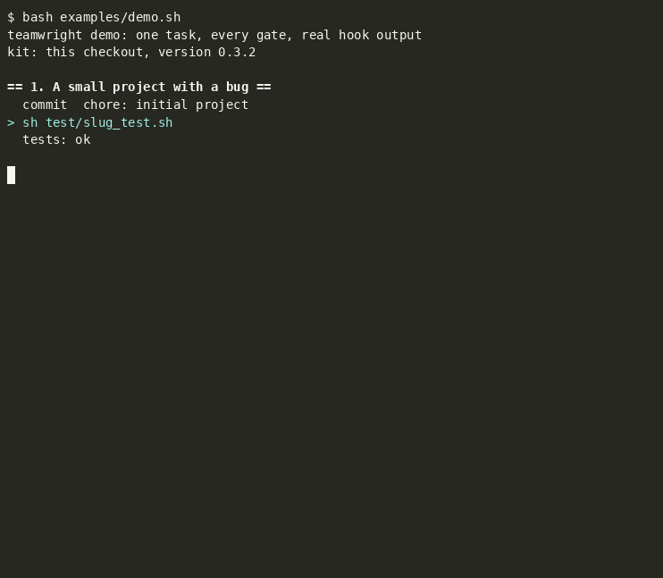
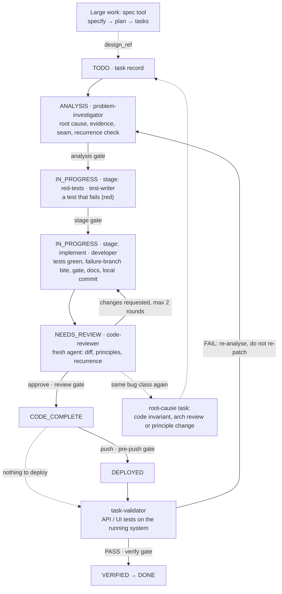

# teamwright

**A team process for AI coding agents, enforced by hooks.** teamwright is a Claude Code plugin. It installs a fixed way of working into your repository — recorded tasks, analysis before code, tests first, review by a separate agent, verification against the running system — plus git and Claude Code hooks that block a step when its evidence is missing.

[](https://github.com/smykov/teamwright/actions/workflows/ci.yml)
[](LICENSE)
[](CHANGELOG.md)

## Why

AI agents write plausible code fast and fail in a few predictable ways. They stop at the first plausible cause. They mark their own work as reviewed. They patch the same class of bug again and again, each patch fine in its own diff. They call a feature done after clicking through it once. They lose half-finished tasks between sessions. Written instructions do not hold: as the context grows, agents drift from them. teamwright turns each of these steps into a record that a hook checks.

| Agent failure | What teamwright does | Enforced by |
|---|---|---|
| fixes the first plausible cause | root cause, evidence and the place of the change are written down before any code edit | analysis gate |
| writes code without a test that fails | a test-writer adds failing tests first; the reviewer checks every guarantee has a test that fails without the change | flow order, reviewer |
| reviews its own work | approval only from a code-reviewer that did not implement the task and whose start is logged | review gate |
| patches the same bug class again | a recurrence verdict sends it to a root-cause task: a code invariant, an architecture review or a principle change | reviewer, review gate |
| "done" after a manual check | `DONE` needs a passing test run against the running system, recorded for the current commit | verify gate |
| switches off its own guardrails to get green | the process config cannot be written from inside Claude Code; strictness only goes up there | state guard |
| wipes other sessions' uncommitted work | `git stash`, `reset --hard`, `checkout --`, force-push and `rm -rf` are denied | Claude Code permissions |
| reports instead of facts | metrics come from git and hook journals, including declared vs actual review; missing data prints `no data`, never `0` | metrics CLI |
| loses tasks between sessions | the next step is computed from git and task records; every session ends with an outcome line | `/teamwright:flow` |

## What's in the box

- **7 role agents:** requirements-reviewer, problem-investigator, test-writer, developer, technical-writer, code-reviewer, task-validator.
- **9 hooks:** analysis, review and verify gates with a state guard, a session journal, a `CLAUDE.md` size check, and git hooks — secret scan, commit message, pre-push, patch guard.
- **15 principles**, each with how it is checked.
- **12 commands:** `adopt`, `init`, `requirements`, `flow`, `status`, `progress`, `blockers`, `settings`, `parallel`, `improve`, `feedback`, `reconfigure`.
- **Tool adapters per capability:** Spec Kit, OpenSpec, Serena, CodeGraphContext, Context7, Playwright, Patrol, Flutter `integration_test`, Maestro, Espresso / XCUITest, your own test runner — or none. Docker runners for toolchains you do not want on the host.
- **Process settings** per project — review threshold, tasks per pass, parallel worktrees, autonomy — on a pipeline that stays the same.
- **Metrics CLI**, a **process review** (`/teamwright:improve`) and a way to send what it finds back here (`/teamwright:feedback`), an **offline demo**, **850 regression checks** of the hooks, installer, router, metrics and scripts.

For developers using Claude Code on a real codebase, for teams bringing agents into an existing project (gates warn first and block once the project's checks are green), and for anyone who wants to measure whether agents help — from git and logs rather than impressions.

## Quickstart

Requires Claude Code, `bash`, `git` and `python3` on Linux or macOS (Docker optional, for toolchains you do not want on the host). Commit your work, then in Claude Code at the repository root:

```text
/plugin marketplace add smykov/teamwright
/plugin install teamwright@teamwright
/teamwright:adopt        # existing project
/teamwright:init <idea>  # new project: empty, or only documents (a brief, a PRD)
/teamwright:flow         # pick the next task and drive it through the loop
```

Both ask before every install, download, rewrite or commit. `adopt` starts the gates in warning mode; you switch them to blocking when your project's checks are green. `init` starts from the requirements, builds a skeleton whose checks are green from day one, and ends with the gates blocking. To see the gates without Claude Code, run the demo: `bash examples/demo.sh` ([what it does](examples/README.md)).



## Channels

Two release channels, two marketplaces from the same repository (Claude Code's release-channel pattern). The plugin's name is `teamwright` in both, so the commands stay `/teamwright:*`.

| Channel | Branch | Add the marketplace | Install | Updates |
|---|---|---|---|---|
| **stable** | `main`, tagged releases | `/plugin marketplace add smykov/teamwright` | `/plugin install teamwright@teamwright` | when the version in `plugin.json` is bumped ([CHANGELOG](CHANGELOG.md)) |
| **experimental** | `next`: the newest feature work, before release | `/plugin marketplace add smykov/teamwright#next` | `/plugin install teamwright@teamwright-next` | every pushed commit: `next` carries no version, so the commit is the version |

**One channel per project.** Both marketplaces can be added on one machine and both plugins installed, but enable exactly one of them in a project — two enabled copies with the same name do not mix, and one copy's hooks silently do not run. Choose in the project's settings: `.claude/settings.json` for the whole team, `.claude/settings.local.json` for this machine only (it wins over the team file):

```json
{
  "enabledPlugins": {
    "teamwright@teamwright": false,
    "teamwright@teamwright-next": true
  }
}
```

The installer (`/teamwright:adopt`, `tw-install.py apply`) enables its own channel in `.claude/settings.json` only when no other channel of teamwright is enabled there or in `settings.local.json`; otherwise it leaves `enabledPlugins` alone and says so.

**Updates of the experimental channel.** Auto-update is off by default for marketplaces other than Anthropic's: pull the branch with `/plugin marketplace update teamwright-next`, then `/plugin update teamwright@teamwright-next` (or turn auto-update on for that marketplace in `/plugin`). Restart, or `/reload-plugins`, to load it. `/teamwright:status` then shows the new commit as a kit update; `tw-install.py apply` brings the project's installed files up to it.

**A working copy.** To try a checkout of the kit without any marketplace: `claude --plugin-dir <path to the checkout>` for one session (disable the installed teamwright in that project first: same name).

## How a task moves



Every arrow marked *gate* is a hook that blocks the status change when its record is missing. Test first: the test-writer's tests are run and shown to fail for the right reason, and committed, before the developer touches the code; the reviewer checks that each guarantee has a test that fails without the change. A reviewer that sees the same class of bug patched again rejects the patch; the task waits for a root-cause task, which ends in a code invariant, an architecture decision or a process change. Each box is also a **stage** — analyze, red-tests, implement, review, verify — that can run in a session of its own, with a fresh context and its own model: `/teamwright:router` asks the router which stage is due and runs that one (one stage per CI job in an autonomous run), and `/teamwright:flow` runs them in a loop in one session. The router script selects the tasks and counts them per stage, so a session reads no task file to find work; batches and thresholds per stage are settings ([sessions.md §8](docs/process/sessions.md#8-stages-one-stage-per-session)). Full lifecycle with every status and exit: [docs/process/lifecycle.md](docs/process/lifecycle.md).

## Practices

What the kit asks of agents, and how each rule is enforced: *written rule* (T0), *reviewer checks* (T1), *hook warns* (T2), *hook blocks* (T3), *tool* for a script that computes a result but forbids nothing. In `gate-first` mode the three Claude Code gates (analysis, review, verify) only warn; they block after `enforce`. Git hooks, the deny list and the state guard behave the same in both modes.

**Planning and analysis**
- Large work (more than one seam, or behaviour not settled) starts in a spec; small work goes straight to a task record. [written rule] — [lifecycle](docs/process/lifecycle.md#0-where-tasks-come-from)
- A task enters `IN_PROGRESS`, and its code is edited, only after the analysis block names the root cause, the evidence, the invariant, the seam and the approach (an `rca` task: root cause, evidence, decision). [hook blocks] — [analysis gate](docs/process/gates.md#analysis-gate)
- The next task is computed from task files: unfinished work first, then ready tasks by priority; a prerequisite inherits the priority of the tasks waiting on it. [tool: router] — [readiness rule](docs/process/lifecycle.md#4-readiness-rule)
- Review returns a task only for findings at or above the project's threshold (`process.review.blocking`); Critical and dangerous categories (secret leak, security, weakened test, done-not-working, recurrence) always do; the rest become one follow-up task per sprint. [hook blocks] — [settings](skills/settings/SKILL.md)
- Tasks per flow pass: one by default; the project sets the cap per priority, one task at a time in the tree, a red gate stops the pass. [router] — [passes](docs/process/sessions.md#3-passes-how-many-tasks-in-a-row)
- Tasks run in parallel only in separate worktrees and sessions, only when their analysed seams do not overlap; each branch is rebased, gated and fast-forwarded in one at a time. [router and tool] — [/teamwright:parallel](skills/parallel/SKILL.md)
- A requirement is read by id, not by reading every document: `scripts/tw-req FR-03` gives its row, the spec sections and the tasks that cite it. [tool] — [usage](docs/usage.md#settings-improve-and-feedback)

**Tests**
- Characterization tests where the seam has none; then a failing test for every guarantee before the implementation, and a reproducing test for every bug. [reviewer checks] — [test-writer](template/.claude/agents/test-writer.md)
- Before the developer starts, the test-writer runs 2–3 deliberately wrong implementations in a throwaway worktree; each must be caught by a test, and the result is in the task record. [reviewer checks] — [test-writer](template/.claude/agents/test-writer.md)
- Once the implementation is green and before review, the test-writer breaks each Acceptance failure branch once on a throwaway copy and runs the test that guards it — for an API task, the end-to-end test verification will run; a surviving mutation means the test is rewritten, so a gap is not first found after deploy. [reviewer checks the table] — [test-writer](template/.claude/agents/test-writer.md#failure-branch-bite-second-spawn-before-review)
- Tests the host cannot run (another platform) run in CI on a `wip/<ID>` branch before review; that push is not a delivery. [hook allows only `wip/*`] — [DRAIN and pause](docs/process/gates.md#drain-and-pause)
- The gate is green before review; the reviewer and the validator run it again instead of trusting the author's report. [reviewer checks] — [AGENTS.md](template/AGENTS.md#gate)
- The full gate runs once per state of the code: `scripts/tw-gate <area>` keeps its whole output in a log and records a PASS for the content of the area's files, so the next role — also after a docs-only commit — gets `PASS (cached: …)` instead of another run; a FAIL is always rerun. `--for-task <ID>` names the gates a task's changes need (a CI-only change needs none). A gate longer than Claude Code's 10-minute Bash limit runs detached: the call returns `RUNNING` (exit 75) and the same command again attaches to it. While working, the developer runs only the task's tests and the touched modules. [tool] — [gate runs](docs/process/gates.md#gate-runs-tw-gate)
- Tests run only through `scripts/tw-test <area> [<tests>]`: the area's configured test command once per state of its files, the whole output in a log, a summary with the failed tests and their first error line; a repeat — a failure too — answers from the cache instead of running again. Calling a test runner or the gate script directly, or piping test output into `tail`/`grep`, is refused. [hook: test-guard, blocks unless `process.test_guard` says otherwise] — [test guard](docs/process/gates.md#test-guard)
- Tests must bite: the reviewer names the line whose removal turns each test red, the validator re-runs the task's mutant catalog (`docs/tasks/<ID>.mutants/`, exact replacements kept in the repository) and adds 15–30 mutants aimed at the guarantees and the changed lines, in a throwaway worktree that its script removes; only a survivor that breaks a stated guarantee fails the task, others become follow-ups; after two failed rounds in a row, a sweep of the changed lines instead of another sample, and after two failed sweeps the owner decides — and a weakened test is a finding of its own. [reviewer and validator check] — [P-005](template/PRINCIPLES.md#p-005--tests-must-bite)
- Every task's acceptance names a failure branch, and an end-to-end test exercises it. [reviewer checks; the verify gate requires a `Failure branch:` line] — [task template](template/docs/tasks/_task-template.md)

**Review**
- Review is a separate `code-reviewer` agent with a fresh context, never a fork of the author. Only it can write the review record, and its start must be in the hook journal. [hook blocks] — [review gate](docs/process/gates.md#review-gate)
- The reviewer does not edit code: every finding goes back to the author. [written rule] — [roles](docs/process/roles.md#why-each-boundary-exists)
- At most two send-backs in a row; the third record escalates to the owner (or rejects a recurrence), never approves. Review records are append-only and rounds are counted from the files. [hook blocks] — [review gate](docs/process/gates.md#review-gate)

**Recurrence**
- Every fix is checked against the history of its area and `docs/failures.md`. The same class of bug patched again is rejected, and a root-cause task takes over the original. [reviewer checks; the hook requires the rca task to exist] — [three exits](docs/process/lifecycle.md#6-recurrence--three-exits)
- A commit that adds another allowlist or regex constant in an area with recent fixes gets a warning; blocking is opt-in. [hook warns] — [patch guard](docs/process/gates.md#patch-guard)
- A recurrence is resolved at its level: code, an architecture review, or an amendment of `PRINCIPLES.md`. The last two are owner decisions, kept in an append-only decision log. [written rule] — [/arch-review](template/.claude/commands/arch-review.md)
- Rules move up the tiers after incidents, and incidents are logged by what happened, not who did it. [written rule] — [principles](docs/process/principles.md#2-why-rules-migrate-up-the-tiers)

**Verification**
- `VERIFIED` and `DONE` need a `PASS` verify record for the current commit, of the kind the task's `surface` requires. Records are append-only; `kind: manual` needs a `verify_exception` and someone other than the implementer. [hook blocks] — [verify gate](docs/process/gates.md#verify-gate)
- Evidence is a committed test run with its report, not an interactive session; the effect is checked in stored data or logs, and a deploy smoke checks the running commit. `DONE` needs the validator's acceptance verdict `PASS` for the current code, written by the validator itself — also for tasks with nothing to deploy. [hook blocks] — [verify gate](docs/process/gates.md#verify-gate), [task-validator](template/.claude/agents/task-validator.md)
- A failed verification sends the task back to analysis, not to a quick patch. [hook blocks `DONE` after a `FAIL`; tool: router] — [verification](docs/process/lifecycle.md#7-verification-of-the-running-system)

**Agent sessions**
- Each role is a fresh subagent run in the foreground; after an interruption the step is rebuilt from git and the task record, not from memory, and every session ends with an `Outcome:` line that a hook journals. [written rule; tool: router] — [sessions](docs/process/sessions.md)
- Before changing a seam, agents find every caller with the configured context tool and check package APIs against the pinned version's docs; an empty result is not proof of absence. [written rule; reviewer checks API calls] — [tools](docs/process/tools.md)
- Agents cannot change the gate config, the mode or the ledgers; config changes go through the installer. [hook blocks] — [state guard](docs/process/gates.md#state-guard)
- `CLAUDE.md` is a map with a size budget. [hook warns] — [CLAUDE.md budget](docs/process/gates.md#claudemd-budget)

**Safety**
- Secret scan on every commit; `.env` and `*.local.json` files are refused. CI repeats it only if your project adds it. [hook blocks] — [secret scan](docs/process/gates.md#secret-scan)
- No `git stash`, `checkout --`, `restore`, `clean`, `reset --hard`, force-push or `rm -rf`; experiments run in a throwaway worktree removed by the same script. [deny list blocks the usual command forms] — [deny list](docs/process/gates.md#deny-list)
- Code leaves the machine only for approved tasks, and a `TEAMWRIGHT_PAUSE` file stops every push. [hook blocks] — [DRAIN and pause](docs/process/gates.md#drain-and-pause)

**Measurement**
- Metrics come from commits, committed records and hook journals, never from agent reports. Every number carries its n and source, a missing source prints `no data` instead of 0, and no metric is a target. [tool: metrics] — [metrics](docs/process/metrics.md#honest-output)

## What the demo shows

`examples/demo.sh` installs the kit into a throwaway repository and walks one bug fix through every gate by sending the hooks the same events Claude Code sends. An excerpt of its output:

```text
== 6. Review gate: approval only from a separate reviewer ==
> orchestrator: T-001 NEEDS_REVIEW -> CODE_COMPLETE
  DENIED by review-gate:
      REVIEW GATE: T-001 cannot become CODE_COMPLETE - no review record in
      docs/tasks/T-001.reviews/. Spawn a fresh code-reviewer subagent for T-001.
      Exit for trivial changes: `review: skipped:trivial`.
> developer writes the review record for its own task
  DENIED by review-gate:
      REVIEW GATE: this agent implemented T-001; its review does not count.
      Spawn a fresh code-reviewer subagent (not a fork of the author) to review
      it.
```

and the metrics report it ends with. The numbers are synthetic — the demo scripts its own commits — and show the format, not results:

| Metric | Value | Source |
|---|---|---|
| agent co-authored commits | 66.7% (4/6) | git log, task-status commits excluded |
| fix share | 16.7% (1/6) | git log, subject matches the fix pattern |
| tasks done | 1 | task-status commits |
| review rounds, mean | 1 (n=1) | `docs/tasks/<ID>.reviews/<n>.md` |
| approved without a review record | 0.0% (0/1) | review records vs `→ CODE_COMPLETE` |
| approvals with a journaled reviewer spawn | 100.0% (1/1) | hook journal vs `→ CODE_COMPLETE` |

Every number carries its n and source; a missing source prints `no data`, never `0`.

## Your first day

**Existing project — `/teamwright:adopt`**

1. **`/teamwright:adopt`** looks at the repository, asks what the next release should achieve and which tools to use, and proposes the test and lint commands for each code area. It writes `.teamwright/config.yml`, installs the hooks, runs every command once and proposes a first sprint of tasks in `docs/tasks/`. Your `CLAUDE.md` and agents are kept, merged with you where they conflict.
2. **Gates warn first.** Until your checks are green, the gates report what they would block. `/teamwright:status` tells you when the project is ready and prints the `enforce` command; you run it yourself or approve Claude Code running it, and from then on the gates block. Lowering the mode back to gate-first is refused inside Claude Code: only you can do it, from your own shell.

**New project — `/teamwright:init`**

1. **Requirements first.** `/teamwright:init` runs `/teamwright:requirements`: your brief is the base, or it interviews you (who the users are, the one flow release 1 must get right, scope and what is out, requirements with a failing example each, measurable quality targets, constraints and what may be installed). A fresh `requirements-reviewer` roasts the draft; its findings come back as a few batched questions until the document is ready, and you approve it. The stack, what "deployed" means and how the UI is verified come out of that roast.
2. **A skeleton that is green from day one.** It scaffolds the stack, adds one real test per area and a version endpoint or screen with the commit, a `make check` gate and a CI workflow running the same gate, installs the hooks, runs every command once and switches the gates to blocking.
3. **Specs and sprint 1.** The spec tool turns the approved requirements into specs and tasks; every Must requirement is covered by a task; T-001 is the first end-to-end slice of the release-1 flow.

**Then, either way**

1. **`/teamwright:flow`** picks the first ready task. A problem-investigator writes the analysis; a test-writer adds a failing test; a developer makes it pass; the orchestrator (the main session) commits locally.
2. **Review.** A fresh code-reviewer reads the diff, the task and the principles and writes a review record. Up to two rounds of changes, then it escalates to you.
3. **Push, verify, accept.** You decide when to push. A task-validator runs the tests against the running system and writes a verify record, then checks every Acceptance item and writes its verdict; with both `PASS` for the current code the task is `DONE`.
4. **`/teamwright:status`** at any time shows the mode, the tasks and the next action. After a week, run `python3 scripts/metrics/teamwright-metrics`.

More on onboarding, gate modes, the flow router, Docker runners, configuration changes, updating and manual install: [docs/usage.md](docs/usage.md).

## Commands

| Command | What it does |
|---|---|
| [`/teamwright:adopt`](skills/adopt/SKILL.md) | existing project: inventory, tool choice, code areas and their commands, hooks in gate-first mode, secret scan, a first sprint |
| [`/teamwright:init`](skills/init/SKILL.md) | new project: requirements first, then the stack they call for, a walking skeleton with a green gate and CI, `enforce`, specs and tasks from the requirements, sprint 1 |
| [`/teamwright:requirements`](skills/requirements/SKILL.md) | builds `docs/requirements.md` from your brief or an interview; a fresh reviewer roasts it until it is ready; you approve it |
| [`/teamwright:flow`](skills/flow/SKILL.md) | asks the router for the next action and drives the task through the lifecycle with fresh role agents, stage after stage, in one session |
| [`/teamwright:router`](skills/router/SKILL.md) | asks the router and runs exactly one stage on the batch it allows, then stops — one stage per session (or per CI job) |
| [`/teamwright:analyze`](skills/analyze/SKILL.md) · [`red-tests`](skills/red-tests/SKILL.md) · [`implement`](skills/implement/SKILL.md) · [`review`](skills/review/SKILL.md) · [`verify`](skills/verify/SKILL.md) | one named stage on its waiting tasks; refuses, naming the right command, when the router says the task is at another stage |
| [`/teamwright:status`](skills/status/SKILL.md) | read-only: mode, settings, whether the context tool indexes your languages and is used, install drift, hooks, tasks, the next action, whether the project is ready for `enforce` |
| [`/teamwright:progress`](skills/progress/SKILL.md) | read-only report for you: done by sprint, plan stage, milestone and area in percent, what is next, what waits for you; `--adapt` fits it to how the repository already tracks work |
| [`/teamwright:blockers`](skills/blockers/SKILL.md) | what waits for you — open questions, escalations, acceptance that needs you, blocked tasks — by class and by what each unblocks; then walks you through answering and records each answer so the flow picks the tasks up |
| [`/teamwright:settings`](skills/settings/SKILL.md) | process settings: review blocking threshold, tasks per flow pass by priority, autonomy, batches and thresholds per stage, model per stage, task selection by the script or the agent; the pipeline stays the same |
| [`/teamwright:parallel`](skills/parallel/SKILL.md) | several tasks at once, each in its own worktree and session, when their seams do not overlap; merges each approved branch back (rebased, gate green) before one push |
| [`/teamwright:improve`](skills/improve/SKILL.md) | measures what the process costs here (send-backs, findings by severity, DRAIN exceptions, context-tool use, before/after a settings change) and proposes changes: a setting, a project rule, or feedback |
| [`/teamwright:feedback`](skills/feedback/SKILL.md) | sends an improvement to this repository — an issue through the forms or a pull request from a fork — anonymised, after you read it |
| [`/teamwright:reconfigure`](skills/reconfigure/SKILL.md) | swaps a tool provider or changes the config through `.teamwright/config.next.yml` |

## Glossary

| Term | Meaning |
|---|---|
| requirements document | `docs/requirements.md`: problem, release-1 goal and scope, EARS requirements with a failing example each, measurable quality targets, constraints, technical decisions; roasted by a requirements-reviewer and approved by you before any spec |
| walking skeleton | the thinnest version of a new project that runs end to end: the app starts, one real test per area, the running system reports its commit, the gate is green |
| task record | `docs/tasks/T-NNN.md`: front matter with status, priority, `surface`, the analysis block; the body has acceptance criteria |
| status | `TODO → ANALYSIS → IN_PROGRESS → NEEDS_REVIEW → CODE_COMPLETE → DEPLOYED → VERIFIED → DONE`; side statuses `BLOCKED`, `DEFERRED`, `VERIFY_FAIL` |
| gate | a hook that checks a status change or an edit and blocks it (or warns, in gate-first mode) with the reason and the exit |
| gate-first / enforce | the two modes: gates warn while a project is being brought up to the process, then block |
| review record | `docs/tasks/<ID>.reviews/<n>.md`, written only by a code-reviewer that did not implement the task; verdict `APPROVE`, `REQUEST_CHANGES`, `REJECT_RECURRENCE` or `ESCALATE` |
| verify record | `docs/tasks/<ID>.verify/<n>.md`: which tests ran against the running system, for which commit, with what result; append-only |
| validation record | `docs/tasks/<ID>.validation/<n>.md`: the task-validator's acceptance verdict (`PASS`, `FAIL`, `NEEDS_OWNER`) for a commit; `DONE` needs the latest `PASS` for the current code |
| surface | what a task changes that can be verified: `api`, `ui`, `both` or `none`; decides which verify records `DONE` needs |
| recurrence | the same class of defect fixed again; the reviewer rejects the patch and a root-cause (`rca`) task takes over |
| seam | the one place in the code where a behaviour is owned, and where a fix belongs |
| tier | how a rule is enforced: T0 written guidance, T1 reviewer checklist, T2 hook warns, T3 hook or CI blocks |
| journal | `.teamwright/logs/*.jsonl`: tool calls, agent starts and session outcomes logged by a hook; no file contents or prompts |
| process settings | `process:` in `.teamwright/config.yml`: review blocking threshold, tasks per pass (per priority), parallel worktrees, autonomy; parameters of fixed steps, set by you through `/teamwright:settings` |
| pass | one `/teamwright:flow` run that takes tasks one after another, up to the cap in the settings |
| follow-up | a review finding below the blocking threshold: the task is approved, the finding goes to the sprint's `review-follow-up` task |

## What gets installed

Paths are in your repository after install; each links to its source in [`template/`](template/). The tiers of the three Claude Code gates are those of `enforce` mode: in `gate-first` they warn (the test guard has its own switch).

| Component | What it does | Tier |
|---|---|---|
| [`scripts/hooks/analysis-gate.sh`](template/scripts/hooks/analysis-gate.sh) | no `IN_PROGRESS` and no code edits of the active task without a filled analysis block | T3 |
| [`scripts/hooks/review-gate.sh`](template/scripts/hooks/review-gate.sh) | review records only from a code-reviewer that did not implement the task; `CODE_COMPLETE` only with an approval and a logged reviewer start; after two send-backs in a row the third record must escalate (or reject a recurrence), never approve; with a review threshold set, the verdict must match the findings table; the state guard | T3 |
| [`scripts/hooks/verify-gate.sh`](template/scripts/hooks/verify-gate.sh) | `VERIFIED` / `DONE` only with a `PASS` verify record for the current code, of the kind the task's `surface` needs; `DONE` also with the task-validator's acceptance `PASS` for that code | T3 |
| [`scripts/hooks/test-guard.sh`](template/scripts/hooks/test-guard.sh) | refuses tests and gates run directly instead of through `tw-test`/`tw-gate`/`tw-mutants`, and test output cut with `tail`/`grep`; its own switch `process.test_guard: block \| warn \| off` (blocks by default, also in `gate-first`) | T3 |
| [`scripts/hooks/journal.sh`](template/scripts/hooks/journal.sh) | logs tool calls, permission events and session outcomes to `.teamwright/logs/` | facts |
| [`scripts/hooks/pre-push`](template/scripts/hooks/pre-push) | pushes only code of approved tasks (docs-only commits belong to no task; `wip/*` branches are CI-only, not deliveries); a `TEAMWRIGHT_PAUSE` file stops all pushes | T3 |
| [`scripts/hooks/pre-commit`](template/scripts/hooks/pre-commit) | secret scan (gitleaks or a built-in fallback); refuses `.env`, `*.local.json` | T3 |
| [`scripts/hooks/commit-msg`](template/scripts/hooks/commit-msg), [`patch-guard.sh`](template/scripts/hooks/patch-guard.sh) | warns on "one more special case" in an area fixed before (blocking is opt-in) | T2 |
| [`scripts/hooks/claude-md-budget.sh`](template/scripts/hooks/claude-md-budget.sh) | warns when `CLAUDE.md` outgrows its size budget | T2 |
| [`scripts/hooks/session-check.sh`](template/scripts/hooks/session-check.sh) | at session start: names what this machine lacks — the plugin, its recorded version, the git hooks | T2 |
| [`.claude/settings.json`](template/.claude/settings.json) | registers the hooks; enables the plugin and names its marketplace, so a fresh clone is offered it; denies `git stash`, `reset --hard`, force-push, `rm -rf` | T3 |
| [`.claude/agents/*.md`](template/.claude/agents/), [`AGENTS.md`](template/AGENTS.md) | roles: requirements-reviewer, problem-investigator, test-writer, developer, technical-writer, code-reviewer, task-validator; the rules for any agent runtime | T0–T1 |
| [`.claude/commands/arch-review.md`](template/.claude/commands/arch-review.md) | architecture review with the owner for a recurrence that crosses seams | T0 |
| [`CLAUDE.md`](template/CLAUDE.md) | the map template: process pointers, where things live, what to know before opening a file | T0 |
| [`PRINCIPLES.md`](template/PRINCIPLES.md) | principles P-001…P-015, each with its tier and check; amended only by the owner | T0–T3 |
| [`docs/`](template/docs/) | templates for the requirements document, tasks, review, verify and validation records, sprints, decisions, open questions; `docs/failures.md` starts empty for your own incidents | T0 |
| [`docs/process/`](docs/process/) | the process reference (all of it except `plugin.md`) | T0 |
| [`scripts/tw-run`](template/scripts/tw-run) | runs an area's command on the host or in the CI's container image | tool |
| [`scripts/tw-gate`](template/scripts/tw-gate) | runs an area's full gate once per state of the area's files, full output in a log, PASS reused on the same content; detached, so it outlives the 10-minute Bash limit (exit 75, call again); `--for-task` lists a task's gates | tool |
| [`scripts/tw-test`](template/scripts/tw-test) | the one way to run tests while working: the area's test command for the tests you name, full output in a log, a short summary (counts, failed tests with their first error, log path), cached per state of the area's files — FAIL included; detached like tw-gate | tool |
| [`scripts/tw-mutants`](template/scripts/tw-mutants) | re-runs a task's mutant catalog on a throwaway copy in one runner start, with generated code copied or generated and a per-copy build cache; fails only on a survivor that breaks a named guarantee | tool |
| [`scripts/metrics/teamwright-metrics`](template/scripts/metrics/teamwright-metrics) | metrics from git, task records and journals | tool |
| [`scripts/tw-req`](template/scripts/tw-req) | one requirement by id: its row, the spec sections and tasks that cite it | tool |
| [`scripts/tw-ci-changes`](template/scripts/tw-ci-changes) | tells CI whether a push carried code or only task records since the previous run | tool |

Every gate has a documented exit for the case where it is wrong (for example `analysis: skipped:trivial` for a typo fix). Gates and exits: [docs/process/gates.md](docs/process/gates.md). Why the kit is shaped this way: [docs/design-decisions.md](docs/design-decisions.md).

## Tools

The process is fixed; the tools that serve it are chosen per project, one per capability, and stored in `.teamwright/config.yml`. No hook depends on a tool: gates read task files and records.

| Capability | Used for | Default | Alternatives | Adapters (what agents are told) |
|---|---|---|---|---|
| `spec` | large work: specify → clarify → plan → tasks | [Spec Kit](https://github.com/github/spec-kit) | [OpenSpec](https://github.com/Fission-AI/OpenSpec), plain `docs/specs/<name>.md` | [spec-kit](providers/spec/spec-kit.md) · [openspec](providers/spec/openspec.md) · [none](providers/spec/none.md) |
| `context` | code-aware search before analysis, implementation and review | [Serena](https://github.com/oraios/serena) | [CodeGraphContext](https://github.com/CodeGraphContext/CodeGraphContext), built-in search | [serena](providers/context/serena.md) · [codegraph](providers/context/codegraph.md) · [builtin](providers/context/builtin.md) |
| `docs` | package API lookup for the pinned version | [Context7](https://github.com/upstash/context7) | the package's own docs | [context7](providers/docs/context7.md) · [none](providers/docs/none.md) |
| `ui_verify` | end-to-end UI runs for UI verify records | [Playwright](https://playwright.dev/) | [Patrol](https://github.com/leancodepl/patrol), [Flutter `integration_test`](https://docs.flutter.dev/testing/integration-tests), [Maestro](https://github.com/mobile-dev-inc/maestro), Espresso / XCUITest, none | [playwright](providers/ui_verify/playwright.md) · [patrol](providers/ui_verify/patrol.md) · [flutter-integration-test](providers/ui_verify/flutter-integration-test.md) · [maestro](providers/ui_verify/maestro.md) · [espresso-xcuitest](providers/ui_verify/espresso-xcuitest.md) · [none](providers/ui_verify/none.md) |
| `api_verify` | API runs for API verify records | the project's own test runner | — | [project-runner](providers/api_verify/project-runner.md) |

`/teamwright:reconfigure` swaps a provider. Details: [docs/process/tools.md](docs/process/tools.md).

## Known limitations

- `review: skipped:trivial` is written into the task record by whoever edits it, the author included. It stays visible to the validator and in the metrics, but nothing prevents it.
- Role limits are written rules: no hook stops the reviewer or the validator from editing code, or an agent from editing `PRINCIPLES.md`.
- Claude Code gates see Edit/Write and obvious shell rewrites; a script that writes files directly bypasses them. Git hooks and review are the backstop.
- `git commit --no-verify` / `git push --no-verify` skip the git hooks. The kit installs no CI workflow: add the secret scan and the gate to your CI if you need a backstop.
- The analysis gate checks code edits only while an active task is declared (`.teamwright/current-task`, set when a task enters `IN_PROGRESS`).
- Ledgers and journals are local (`.teamwright/`, gitignored): a review done on another machine is not recognised, and a machine without journals is absent from metrics, not zero.
- The `/teamwright:*` commands live in the plugin, not in the repository: a fresh clone needs the plugin installed and `bash scripts/install-hooks.sh` run once. The project settings offer the plugin and a session-start check names what is missing ([usage](docs/usage.md#another-machine-or-a-fresh-clone)).
- One active task per working tree; parallel sessions need separate worktrees.
- The review gate trusts `agent_type`: whoever can edit `.claude/agents/` can name an agent `code-reviewer`. Review agent definitions like code.
- The deny list matches command text, not every form of a command (`sh -c`, scripts).
- Patch-guard signatures and fix detection are heuristics: expect false positives until tuned to your stack.
- Metrics depend on conventions: missing `Co-Authored-By:` trailers, fixes not called fixes, squash merges and area granularity all move the numbers. No metric is a target.
- The verify gate checks that a `PASS` record exists for the current code, not that the tests were meaningful; the reviewer and the validator judge that.
- Tool-level gates are Claude Code-specific; other runtimes get `AGENTS.md`, the git hooks and the metrics.
- 0.x: behaviour may change between minor versions ([CHANGELOG.md](CHANGELOG.md)).

## Documentation

- [docs/README.md](docs/README.md) — index of the documentation, with a reading order
- [docs/usage.md](docs/usage.md) — onboarding, gate modes, `/teamwright:flow`, Docker runners, configuration, updating, manual install, metrics
- [docs/process/](docs/process/) — the process reference installed into projects: [lifecycle](docs/process/lifecycle.md), [gates](docs/process/gates.md), [roles](docs/process/roles.md), [sessions](docs/process/sessions.md), [principles](docs/process/principles.md), [metrics](docs/process/metrics.md), [tools](docs/process/tools.md); installer and config schema in [plugin.md](docs/process/plugin.md)
- [skills/](skills/) — the commands above; [providers/](providers/) — one adapter per tool
- [docs/design-decisions.md](docs/design-decisions.md) — why the kit is shaped this way
- [CHANGELOG.md](CHANGELOG.md) — what changed in each version
- [examples/](examples/) — the offline demo
- [CONTRIBUTING.md](CONTRIBUTING.md) · [SECURITY.md](SECURITY.md) · [CODE_OF_CONDUCT.md](CODE_OF_CONDUCT.md)

## Status

Early: 0.x, built and tried by its author on real projects — adoption of one existing project and the task loop on it, dry runs of `/teamwright:init`, and a first multi-day run of the whole loop on a new project, whose feedback shaped 0.5–0.7 (review threshold, passes, parallel worktrees, CI-only tests). Bug reports from other stacks are the most useful contribution.

## Roadmap

- A live `/teamwright:init` on a new product with its owner: requirements → skeleton → specs → tasks → lifecycle → verification → metrics.
- More provider adapters (spec, context and UI runners) as projects need them.
- A Spec Kit extension or preset: task and constitution templates and a `tasks.md` → task-record bridge. The deterministic gates stay Claude Code and git hooks.
- Tool-level gates for more agent runtimes.

## Author and license

Konstantin Smykov ([@smykov](https://github.com/smykov)) — agent teamwright: an engineering lead who builds software with AI agent teams. The principles come from incidents in a year of running an agent team on a live multi-service project.

MIT — see [LICENSE](LICENSE).
