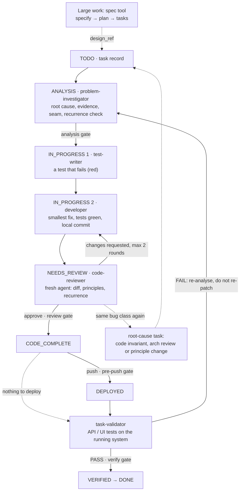

# teamwright

A Claude Code plugin that installs a team process into your repository: AI agents work on recorded tasks, and hooks block the steps they tend to skip — analysis, independent review, verification.

[](https://github.com/smykov/teamwright/actions/workflows/ci.yml)
[](LICENSE)
[](CHANGELOG.md)

- **Analysis before code.** A task cannot start until the root cause, the evidence and the place of the change are written down; while it is the active task, code edits are checked against that analysis.
- **Review that actually ran.** Only a separate reviewer agent, logged when it was started, can approve a task. It also checks whether the same kind of bug was patched before.
- **Done means verified.** A task closes only with a recorded passing test run for the current commit. The process is measured from git and hook logs, not from what agents report.

## Quickstart

Requires Claude Code, `bash`, `git` and `python3` on Linux or macOS (Docker optional, for toolchains you do not want on the host). Commit your work, then in Claude Code at the repository root:

```text
/plugin marketplace add smykov/teamwright
/plugin install teamwright@teamwright
/teamwright:adopt        # existing project; /teamwright:init for a new one
/teamwright:flow         # pick the next task and drive it through the loop
```

`adopt` asks before every install, rewrite or commit. Gates start by warning; you switch them to blocking when your project's checks are green. To see the gates without Claude Code, run the demo: `bash examples/demo.sh` ([what it does](examples/README.md)).


## How a task moves



Every arrow marked *gate* is a hook that blocks the status change when its record is missing. Test first: the test-writer's tests are run and shown to fail for the right reason, and committed, before the developer touches the code; the reviewer checks that each guarantee has a test that fails without the change. A reviewer that sees the same class of bug patched again rejects the patch; the task waits for a root-cause task, which ends in a code invariant, an architecture decision or a process change. Full lifecycle with every status and exit: [docs/process/lifecycle.md](docs/process/lifecycle.md).

## Practices

What the kit asks of agents, and how each rule is enforced: *written rule* (T0), *reviewer checks* (T1), *hook warns* (T2), *hook blocks* (T3), *tool* for a script that computes a result but forbids nothing. In `gate-first` mode the three Claude Code gates (analysis, review, verify) only warn; they block after `enforce`. Git hooks, the deny list and the state guard behave the same in both modes.

**Planning and analysis**
- Large work (more than one seam, or behaviour not settled) starts in a spec; small work goes straight to a task record. [written rule] — [lifecycle](docs/process/lifecycle.md#0-where-tasks-come-from)
- A task enters `IN_PROGRESS`, and its code is edited, only after the analysis block names the root cause, the evidence, the invariant, the seam and the approach (an `rca` task: root cause, evidence, decision). [hook blocks] — [analysis gate](docs/process/gates.md#analysis-gate)
- The next task is computed from task files: unfinished work first, then ready tasks by priority; a prerequisite inherits the priority of the tasks waiting on it. [tool: router] — [readiness rule](docs/process/lifecycle.md#4-readiness-rule)
- One task per session by default, at most three low-priority ones; a red gate fails the whole batch. [written rule] — [batching](docs/process/sessions.md#3-batching)

**Tests**
- Characterization tests where the seam has none; then a failing test for every guarantee before the implementation, and a reproducing test for every bug. [reviewer checks] — [test-writer](template/.claude/agents/test-writer.md)
- The gate is green before review; the reviewer and the validator run it again instead of trusting the author's report. [reviewer checks] — [AGENTS.md](template/AGENTS.md#gate)
- Tests must bite: the reviewer names the line whose removal turns each test red, the validator applies 3–6 mutations on a throwaway copy of the tree, and a weakened test is a finding of its own. [reviewer and validator check] — [P-005](template/PRINCIPLES.md#p-005--tests-must-bite)
- Every task's acceptance names a failure branch, and an end-to-end test exercises it. [reviewer checks; the verify gate requires a `Failure branch:` line] — [task template](template/docs/tasks/_task-template.md)

**Review**
- Review is a separate `code-reviewer` agent with a fresh context, never a fork of the author. Only it can write the review record, and its start must be in the hook journal. [hook blocks] — [review gate](docs/process/gates.md#review-gate)
- The reviewer does not edit code: every finding goes back to the author. [written rule] — [roles](docs/process/roles.md#why-each-boundary-exists)
- At most two send-backs in a row; the third record escalates to the owner (or rejects a recurrence), never approves. Review records are append-only and rounds are counted from the files. [hook blocks] — [review gate](docs/process/gates.md#review-gate)

**Recurrence**
- Every fix is checked against the history of its area and `docs/failures.md`. The same class of bug patched again is rejected, and a root-cause task takes over the original. [reviewer checks; the hook requires the rca task to exist] — [three exits](docs/process/lifecycle.md#6-recurrence--three-exits)
- A commit that adds another allowlist or regex constant in an area with recent fixes gets a warning; blocking is opt-in. [hook warns] — [patch guard](docs/process/gates.md#patch-guard)
- A recurrence is resolved at its level: code, an architecture review, or an amendment of `PRINCIPLES.md`. The last two are owner decisions, kept in an append-only decision log. [written rule] — [/arch-review](template/.claude/commands/arch-review.md)
- Rules move up the tiers after incidents, and incidents are logged by what happened, not who did it. [written rule] — [principles](docs/process/principles.md#2-why-rules-migrate-up-the-tiers)

**Verification**
- `VERIFIED` and `DONE` need a `PASS` verify record for the current commit, of the kind the task's `surface` requires. Records are append-only; `kind: manual` needs a `verify_exception` and someone other than the implementer. [hook blocks] — [verify gate](docs/process/gates.md#verify-gate)
- Evidence is a committed test run with its report, not an interactive session; the effect is checked in stored data or logs, and a deploy smoke checks the running commit. The validator's acceptance verdict decides `DONE`. [validator checks] — [task-validator](template/.claude/agents/task-validator.md)
- A failed verification sends the task back to analysis, not to a quick patch. [hook blocks `DONE` after a `FAIL`; tool: router] — [verification](docs/process/lifecycle.md#7-verification-of-the-running-system)

**Agent sessions**
- Each role is a fresh subagent run in the foreground; after an interruption the step is rebuilt from git and the task record, not from memory, and every session ends with an `Outcome:` line that a hook journals. [written rule; tool: router] — [sessions](docs/process/sessions.md)
- Before changing a seam, agents find every caller with the configured context tool and check package APIs against the pinned version's docs; an empty result is not proof of absence. [written rule; reviewer checks API calls] — [tools](docs/process/tools.md)
- Agents cannot change the gate config, the mode or the ledgers; config changes go through the installer. [hook blocks] — [state guard](docs/process/gates.md#state-guard)
- `CLAUDE.md` is a map with a size budget. [hook warns] — [CLAUDE.md budget](docs/process/gates.md#claudemd-budget)

**Safety**
- Secret scan on every commit; `.env` and `*.local.json` files are refused. CI repeats it only if your project adds it. [hook blocks] — [secret scan](docs/process/gates.md#secret-scan)
- No `git stash`, `checkout --`, `restore`, `clean`, `reset --hard`, force-push or `rm -rf`; experiments run on a throwaway copy or worktree. [deny list blocks the usual command forms] — [deny list](docs/process/gates.md#deny-list)
- Code leaves the machine only for approved tasks, and a `TEAMWRIGHT_PAUSE` file stops every push. [hook blocks] — [DRAIN and pause](docs/process/gates.md#drain-and-pause)

**Measurement**
- Metrics come from commits, committed records and hook journals, never from agent reports. Every number carries its n and source, a missing source prints `no data` instead of 0, and no metric is a target. [tool: metrics] — [metrics](docs/process/metrics.md#honest-output)

## What the demo shows

`examples/demo.sh` installs the kit into a throwaway repository and walks one bug fix through every gate by sending the hooks the same events Claude Code sends. An excerpt of its output:

```text
== 6. Review gate: approval only from a separate reviewer ==
> orchestrator: T-001 NEEDS_REVIEW -> CODE_COMPLETE
  DENIED by review-gate:
      REVIEW GATE: T-001 cannot become CODE_COMPLETE - no review record in
      docs/tasks/T-001.reviews/. Spawn a fresh code-reviewer subagent for T-001.
      Exit for trivial changes: `review: skipped:trivial`.
> developer writes the review record for its own task
  DENIED by review-gate:
      REVIEW GATE: this agent implemented T-001; its review does not count.
      Spawn a fresh code-reviewer subagent (not a fork of the author) to review
      it.
```

and the metrics report it ends with. The numbers are synthetic — the demo scripts its own commits — and show the format, not results:

| Metric | Value | Source |
|---|---|---|
| agent co-authored commits | 66.7% (4/6) | git log, task-status commits excluded |
| fix share | 16.7% (1/6) | git log, subject matches the fix pattern |
| tasks done | 1 | task-status commits |
| review rounds, mean | 1 (n=1) | `docs/tasks/<ID>.reviews/<n>.md` |
| approved without a review record | 0.0% (0/1) | review records vs `→ CODE_COMPLETE` |
| approvals with a journaled reviewer spawn | 100.0% (1/1) | hook journal vs `→ CODE_COMPLETE` |

Every number carries its n and source; a missing source prints `no data`, never `0`.

## Your first day

1. **`/teamwright:adopt`** looks at the repository, asks what the next release should achieve and which tools to use, and proposes the test and lint commands for each code area. It writes `.teamwright/config.yml`, installs the hooks, runs every command once and proposes a first sprint of tasks in `docs/tasks/`. Your `CLAUDE.md` and agents are kept, merged with you where they conflict.
2. **Gates warn first.** Until your checks are green, the gates report what they would block. `/teamwright:status` tells you when the project is ready and prints the `enforce` command; you run it yourself or approve Claude Code running it, and from then on the gates block. Lowering the mode back to gate-first is refused inside Claude Code: only you can do it, from your own shell.
3. **`/teamwright:flow`** picks the first ready task. A problem-investigator writes the analysis; a test-writer adds a failing test; a developer makes it pass; the orchestrator (the main session) commits locally.
4. **Review.** A fresh code-reviewer reads the diff, the task and the principles and writes a review record. Up to two rounds of changes, then it escalates to you.
5. **Push and verify.** You decide when to push. A task-validator runs the tests against the running system and writes a verify record; with a `PASS` for the current commit the task is `DONE`.
6. **`/teamwright:status`** at any time shows the mode, the tasks and the next action. After a week, run `python3 scripts/metrics/teamwright-metrics`.

More on onboarding, gate modes, the flow router, Docker runners, configuration changes, updating and manual install: [docs/usage.md](docs/usage.md).

## Commands

| Command | What it does |
|---|---|
| [`/teamwright:adopt`](skills/adopt/SKILL.md) | existing project: inventory, tool choice, code areas and their commands, hooks in gate-first mode, secret scan, a first sprint |
| [`/teamwright:init`](skills/init/SKILL.md) | new project: the same setup, starting from a spec when the work is large |
| [`/teamwright:flow`](skills/flow/SKILL.md) | asks the router for the next action and drives the task through the lifecycle with fresh role agents |
| [`/teamwright:status`](skills/status/SKILL.md) | read-only: mode, install drift, hooks, tasks, the next action, whether the project is ready for `enforce` |
| [`/teamwright:reconfigure`](skills/reconfigure/SKILL.md) | swaps a tool provider or changes the config through `.teamwright/config.next.yml` |

## Glossary

| Term | Meaning |
|---|---|
| task record | `docs/tasks/T-NNN.md`: front matter with status, priority, `surface`, the analysis block; the body has acceptance criteria |
| status | `TODO → ANALYSIS → IN_PROGRESS → NEEDS_REVIEW → CODE_COMPLETE → DEPLOYED → VERIFIED → DONE`; side statuses `BLOCKED`, `DEFERRED`, `VERIFY_FAIL` |
| gate | a hook that checks a status change or an edit and blocks it (or warns, in gate-first mode) with the reason and the exit |
| gate-first / enforce | the two modes: gates warn while a project is being brought up to the process, then block |
| review record | `docs/tasks/<ID>.reviews/<n>.md`, written only by a code-reviewer that did not implement the task; verdict `APPROVE`, `REQUEST_CHANGES`, `REJECT_RECURRENCE` or `ESCALATE` |
| verify record | `docs/tasks/<ID>.verify/<n>.md`: which tests ran against the running system, for which commit, with what result; append-only |
| surface | what a task changes that can be verified: `api`, `ui`, `both` or `none`; decides which verify records `DONE` needs |
| recurrence | the same class of defect fixed again; the reviewer rejects the patch and a root-cause (`rca`) task takes over |
| seam | the one place in the code where a behaviour is owned, and where a fix belongs |
| tier | how a rule is enforced: T0 written guidance, T1 reviewer checklist, T2 hook warns, T3 hook or CI blocks |
| journal | `.teamwright/logs/*.jsonl`: tool calls, agent starts and session outcomes logged by a hook; no file contents or prompts |

## What gets installed

Paths are in your repository after install; each links to its source in [`template/`](template/). The tiers of the three Claude Code gates are those of `enforce` mode: in `gate-first` they warn.

| Component | What it does | Tier |
|---|---|---|
| [`scripts/hooks/analysis-gate.sh`](template/scripts/hooks/analysis-gate.sh) | no `IN_PROGRESS` and no code edits of the active task without a filled analysis block | T3 |
| [`scripts/hooks/review-gate.sh`](template/scripts/hooks/review-gate.sh) | review records only from a code-reviewer that did not implement the task; `CODE_COMPLETE` only with an approval and a logged reviewer start; after two send-backs in a row the third record must escalate (or reject a recurrence), never approve; the state guard | T3 |
| [`scripts/hooks/verify-gate.sh`](template/scripts/hooks/verify-gate.sh) | `VERIFIED` / `DONE` only with a `PASS` verify record for the current code, of the kind the task's `surface` needs | T3 |
| [`scripts/hooks/journal.sh`](template/scripts/hooks/journal.sh) | logs tool calls, permission events and session outcomes to `.teamwright/logs/` | facts |
| [`scripts/hooks/pre-push`](template/scripts/hooks/pre-push) | pushes only code of approved tasks; a `TEAMWRIGHT_PAUSE` file stops all pushes | T3 |
| [`scripts/hooks/pre-commit`](template/scripts/hooks/pre-commit) | secret scan (gitleaks or a built-in fallback); refuses `.env`, `*.local.json` | T3 |
| [`scripts/hooks/commit-msg`](template/scripts/hooks/commit-msg), [`patch-guard.sh`](template/scripts/hooks/patch-guard.sh) | warns on "one more special case" in an area fixed before (blocking is opt-in) | T2 |
| [`scripts/hooks/claude-md-budget.sh`](template/scripts/hooks/claude-md-budget.sh) | warns when `CLAUDE.md` outgrows its size budget | T2 |
| [`.claude/settings.json`](template/.claude/settings.json) | registers the hooks; denies `git stash`, `reset --hard`, force-push, `rm -rf` | T3 |
| [`.claude/agents/*.md`](template/.claude/agents/), [`AGENTS.md`](template/AGENTS.md) | roles: problem-investigator, test-writer, developer, technical-writer, code-reviewer, task-validator; the rules for any agent runtime | T0–T1 |
| [`.claude/commands/arch-review.md`](template/.claude/commands/arch-review.md) | architecture review with the owner for a recurrence that crosses seams | T0 |
| [`CLAUDE.md`](template/CLAUDE.md) | the map template: process pointers, where things live, what to know before opening a file | T0 |
| [`PRINCIPLES.md`](template/PRINCIPLES.md) | principles P-001…P-015, each with its tier and check; amended only by the owner | T0–T3 |
| [`docs/`](template/docs/) | templates for tasks, review and verify records, sprints, decisions, open questions; `docs/failures.md` starts empty for your own incidents | T0 |
| [`docs/process/`](docs/process/) | the process reference (all of it except `plugin.md`) | T0 |
| [`scripts/tw-run`](template/scripts/tw-run) | runs an area's command on the host or in the CI's container image | tool |
| [`scripts/metrics/teamwright-metrics`](template/scripts/metrics/teamwright-metrics) | metrics from git, task records and journals | tool |

Every gate has a documented exit for the case where it is wrong (for example `analysis: skipped:trivial` for a typo fix). Gates and exits: [docs/process/gates.md](docs/process/gates.md). Why the kit is shaped this way: [docs/design-decisions.md](docs/design-decisions.md).

## Tools

The process is fixed; the tools that serve it are chosen per project, one per capability, and stored in `.teamwright/config.yml`. No hook depends on a tool: gates read task files and records.

| Capability | Used for | Default | Alternatives | Adapters (what agents are told) |
|---|---|---|---|---|
| `spec` | large work: specify → clarify → plan → tasks | [Spec Kit](https://github.com/github/spec-kit) | [OpenSpec](https://github.com/Fission-AI/OpenSpec), plain `docs/specs/<name>.md` | [spec-kit](providers/spec/spec-kit.md) · [openspec](providers/spec/openspec.md) · [none](providers/spec/none.md) |
| `context` | code-aware search before analysis, implementation and review | [Serena](https://github.com/oraios/serena) | [CodeGraphContext](https://github.com/CodeGraphContext/CodeGraphContext), built-in search | [serena](providers/context/serena.md) · [codegraph](providers/context/codegraph.md) · [builtin](providers/context/builtin.md) |
| `docs` | package API lookup for the pinned version | [Context7](https://github.com/upstash/context7) | the package's own docs | [context7](providers/docs/context7.md) · [none](providers/docs/none.md) |
| `ui_verify` | end-to-end UI runs for UI verify records | [Playwright](https://playwright.dev/) | [Patrol](https://github.com/leancodepl/patrol), [Flutter `integration_test`](https://docs.flutter.dev/testing/integration-tests), [Maestro](https://github.com/mobile-dev-inc/maestro), Espresso / XCUITest, none | [playwright](providers/ui_verify/playwright.md) · [patrol](providers/ui_verify/patrol.md) · [flutter-integration-test](providers/ui_verify/flutter-integration-test.md) · [maestro](providers/ui_verify/maestro.md) · [espresso-xcuitest](providers/ui_verify/espresso-xcuitest.md) · [none](providers/ui_verify/none.md) |
| `api_verify` | API runs for API verify records | the project's own test runner | — | [project-runner](providers/api_verify/project-runner.md) |

`/teamwright:reconfigure` swaps a provider. Details: [docs/process/tools.md](docs/process/tools.md).

## Known limitations

- `review: skipped:trivial` is written into the task record by whoever edits it, the author included. It stays visible to the validator and in the metrics, but nothing prevents it.
- Role limits are written rules: no hook stops the reviewer or the validator from editing code, or an agent from editing `PRINCIPLES.md`.
- Claude Code gates see Edit/Write and obvious shell rewrites; a script that writes files directly bypasses them. Git hooks and review are the backstop.
- `git commit --no-verify` / `git push --no-verify` skip the git hooks. The kit installs no CI workflow: add the secret scan and the gate to your CI if you need a backstop.
- The analysis gate checks code edits only while an active task is declared (`.teamwright/current-task`, set when a task enters `IN_PROGRESS`).
- Ledgers and journals are local (`.teamwright/`, gitignored): a review done on another machine is not recognised, and a machine without journals is absent from metrics, not zero.
- One active task per working tree; parallel sessions need separate worktrees.
- The review gate trusts `agent_type`: whoever can edit `.claude/agents/` can name an agent `code-reviewer`. Review agent definitions like code.
- The deny list matches command text, not every form of a command (`sh -c`, scripts).
- Patch-guard signatures and fix detection are heuristics: expect false positives until tuned to your stack.
- Metrics depend on conventions: missing `Co-Authored-By:` trailers, fixes not called fixes, squash merges and area granularity all move the numbers. No metric is a target.
- The verify gate checks that a `PASS` record exists for the current code, not that the tests were meaningful; the reviewer and the validator judge that.
- Tool-level gates are Claude Code-specific; other runtimes get `AGENTS.md`, the git hooks and the metrics.
- 0.x: behaviour may change between minor versions ([CHANGELOG.md](CHANGELOG.md)).

## Documentation

- [docs/README.md](docs/README.md) — index of the documentation, with a reading order
- [docs/usage.md](docs/usage.md) — onboarding, gate modes, `/teamwright:flow`, Docker runners, configuration, updating, manual install, metrics
- [docs/process/](docs/process/) — the process reference installed into projects: [lifecycle](docs/process/lifecycle.md), [gates](docs/process/gates.md), [roles](docs/process/roles.md), [sessions](docs/process/sessions.md), [principles](docs/process/principles.md), [metrics](docs/process/metrics.md), [tools](docs/process/tools.md); installer and config schema in [plugin.md](docs/process/plugin.md)
- [skills/](skills/) — the commands above; [providers/](providers/) — one adapter per tool
- [docs/design-decisions.md](docs/design-decisions.md) — why the kit is shaped this way
- [CHANGELOG.md](CHANGELOG.md) — what changed in each version
- [examples/](examples/) — the offline demo
- [CONTRIBUTING.md](CONTRIBUTING.md) · [SECURITY.md](SECURITY.md) · [CODE_OF_CONDUCT.md](CODE_OF_CONDUCT.md)

## Status

Early: 0.x, built and tried by its author on real projects — so far adoption of one existing project and the task loop on it. Bug reports from other stacks are the most useful contribution.

## Roadmap

- End-to-end run of `/teamwright:init` on a new project: spec → tasks → lifecycle → verification → metrics.
- More provider adapters (spec, context and UI runners) as projects need them.
- A Spec Kit extension or preset: task and constitution templates and a `tasks.md` → task-record bridge. The deterministic gates stay Claude Code and git hooks.
- Tool-level gates for more agent runtimes.

## Author and license

Konstantin Smykov ([@smykov](https://github.com/smykov)). MIT — see [LICENSE](LICENSE).
