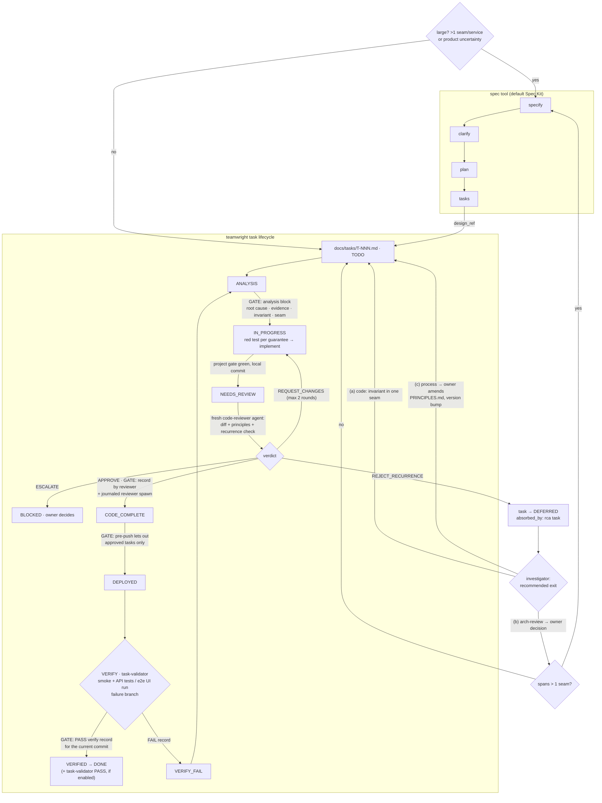

# teamwright

> A fixed team process for AI coding agents, with pluggable tools (default: [GitHub Spec Kit](https://github.com/github/spec-kit) for specs): task lifecycle, test-first work, separate review with recurrence detection, recorded verification of the running system, and metrics from git and hook journals.

**Status: 0.x — usable, early.** The gates, agents, templates, metrics CLI and installer work and are covered by regression tests. Install as a Claude Code plugin, run `/teamwright:adopt` (existing project) or `/teamwright:init` (new project), then `/teamwright:flow` to work; see [Quickstart](#quickstart).

Agent teams fail in familiar ways. An agent reports a review that never ran. A class of bug gets one more `if` per incident, and each patch passes review because it looks fine on its own. A task is marked done and does not work on the input that broke it. Instructions alone don't stop this; teamwright turns the few rules that must hold into hooks, and measures the process from records the agents cannot rewrite.

## How it fits with your tools

The **process** below is fixed. The **tools** that serve it are chosen per project at onboarding, one per capability — see [Tools](#tools). The defaults are shown here.


**Foundation — a spec tool** (default Spec Kit; OpenSpec or plain spec files as alternatives), with a code-aware context tool (default [Serena](https://github.com/oraios/serena)) instead of text search. It owns specifications and the start of **large** work — anything that spans more than one seam or service, or where the product behaviour is not settled: specify → clarify → plan → tasks. Every task created from a spec carries `design_ref` back to it. Small work (one seam, agreed behaviour) goes straight to a task record. Spec Kit's `implement` step is replaced by the teamwright lifecycle.

**Per task — teamwright:** analysis with evidence → a failing test for every guarantee → implement → project gate green → review by a separate agent, including a recurrence check → push only after approval → **verification of the running system** → done.

**Verification** is a recorded step, not a claim. Each task declares `surface: api | ui | both | none`. In the VERIFY session the task-validator runs committed tests against the running system — API tests for APIs; an end-to-end UI test run for UI ([Playwright](https://playwright.dev/) for web; Flutter `integration_test` / Patrol / Maestro, or native Espresso / XCUITest, for mobile); a smoke that the deploy runs the pushed commit — on the input that reproduced the problem, and writes `docs/tasks/<ID>.verify/<n>.md`. `VERIFIED` and `DONE` require a `PASS` record for the current code. Interactive tools (Playwright MCP, an emulator) help explore; the evidence is a test run.

**Recurrence → three exits.** When review finds the same class of defect patched again, the patch is not accepted: the task is deferred into a root-cause (`rca`) task, and the investigator recommends the level where the class lives — **(a) code:** an invariant in one seam; **(b) architecture:** `/arch-review` weighs options using hotspots from the metrics, the owner decides, and a change across seams goes back through Spec Kit; **(c) process:** the owner amends `PRINCIPLES.md` in a separate, versioned commit. Every exit ends in `docs/decisions.md`.



`GATE` marks transitions enforced by hooks (T3). The verify gate checks that a `PASS` record exists for the current code; teamwright does not run your API or UI tests itself — the VERIFY session does. Tasks with `deploys: false` go from `CODE_COMPLETE` to `DONE` — verified against a locally started system, or with no record when `surface: none`.

Today the bridge is manual: each item of the spec tool's task list becomes a `docs/tasks/T-NNN.md` record with `design_ref` (the analysis gate checks code edits only while a teamwright task is active).

## What's inside

Paths are relative to `template/`, which becomes your repository root after install. Tiers: **T0** written guidance · **T1** reviewer checklist · **T2** hook warns · **T3** hook/CI blocks, with a recorded exit.

| Component | Files | Tier |
|---|---|---|
| Analysis gate — no `IN_PROGRESS` and no code edits without a filled analysis block | `scripts/hooks/analysis-gate.sh` (Claude Code hook) | T3 |
| Review gate — review records only from a `code-reviewer` agent that did not implement the task; `CODE_COMPLETE` only with an approval in the ledger and a journaled reviewer spawn; a third `REQUEST_CHANGES` must be `ESCALATE` | `scripts/hooks/review-gate.sh` | T3 |
| Journal — tool calls, permission events and session outcomes as JSON Lines; no file contents or prompts | `scripts/hooks/journal.sh` → `.teamwright/logs/` | facts for gates and metrics |
| Deny list — `git stash`, `checkout --`, `reset --hard`, force-push, `rm -rf` | `.claude/settings.json` | T3 |
| Patch guard — warns on "one more case / allowlist entry" in an area fixed before; exits: `RCA: T-NNN` trailer, `Principle-Override:` | `scripts/hooks/commit-msg`, `patch-guard.sh`, `patch-guard.conf` | T2 (T3 opt-in) |
| DRAIN / pause — pushes only code of approved tasks; a `TEAMWRIGHT_PAUSE` file stops all pushes | `scripts/hooks/pre-push` | T3 |
| Secret scan — gitleaks or a built-in fallback; refuses `.env`, `*.local.json` | `scripts/hooks/pre-commit`, `.gitleaks.toml` | T3 |
| CLAUDE.md budget — warns when the context file grows past 40 KB | `scripts/hooks/claude-md-budget.sh` | T2 |
| Verify gate — `VERIFIED` / `DONE` only with a `PASS` verify record for the current code, per the task's `surface`; `kind: manual` only with a `verify_exception` | `scripts/hooks/verify-gate.sh`, `docs/tasks/_verify-template.md` | T3 |
| Agents — problem-investigator (recommends the recurrence exit), test-writer (incl. end-to-end tests for the failure branch), developer, technical-writer, code-reviewer, task-validator (verification runs + DoD evidence + mutations on a throwaway copy) | `.claude/agents/*.md`, `AGENTS.md` (runtime-neutral) | T0–T1 |
| `/arch-review` — recurrence exit (b): hotspots + seams → options with trade-offs → owner decision → spec/plan or tasks | `.claude/commands/arch-review.md` | T0 |
| Principles P-001…P-015, each with its tier and how it is checked; versioned, amended only by the owner | `PRINCIPLES.md` | T0–T3 per entry |
| Docs templates — task, review record, verify record, sprint, decisions, requirements; `docs/failures.md` ships empty | `docs/**` | T0 |
| Metrics CLI — git history, task transitions, review records, journals | `scripts/metrics/teamwright-metrics` | measurement |
| Process reference the agents link to | `docs/process/*.md` (kit repo, copied on install) | T0 |
| Tool adapters — install steps, MCP entry and the rules agents follow for each provider; rendered between `teamwright:tools` markers in `AGENTS.md` and the role files | `providers/<capability>/<provider>.md` (kit), [docs/process/tools.md](docs/process/tools.md) | T0 |
| End-to-end UI runners — Playwright for web (+ [Playwright MCP](https://github.com/microsoft/playwright-mcp) for exploration); Flutter `integration_test` / Patrol / Maestro for mobile; your API test suite | not shipped; the verify gate reads records, not tools | your stack |

Every shipped principle comes from an incident on a real project; `docs/failures.md` ships empty and is for your project's own incidents. Why the kit is shaped this way: [docs/design-decisions.md](docs/design-decisions.md).

## Tools

| Capability | Serves in the process | Default | Alternatives |
|---|---|---|---|
| `spec` | large work: specify → clarify → plan → tasks; tasks carry `design_ref` | [Spec Kit](https://github.com/github/spec-kit) | [OpenSpec](https://github.com/Fission-AI/OpenSpec), `none` (plain `docs/specs/<name>.md`) |
| `context` | code-aware context before analysis, implementation, review | [Serena](https://github.com/oraios/serena) (MCP) | [CodeGraphContext](https://github.com/CodeGraphContext/CodeGraphContext) (MCP), `builtin` (grep, glob, LSP) |
| `docs` | package API lookup for the pinned version | [Context7](https://github.com/upstash/context7) (MCP) | `none` (the package's own docs) |
| `ui_verify` | end-to-end UI runs for `kind: ui` verify records | [Playwright](https://playwright.dev/) for web (+ Playwright MCP to explore) | [Patrol](https://github.com/leancodepl/patrol), [Flutter `integration_test`](https://docs.flutter.dev/testing/integration-tests), [Maestro](https://github.com/mobile-dev-inc/maestro), Espresso / XCUITest, `none` |
| `api_verify` | API runs for `kind: api` verify records | the project's own runner (Jest + supertest, pytest + httpx, …) | — |

The choice lives in `.teamwright/config.yml`. No hook depends on a tool: gates read task files and records, and a verify record names the tool that produced it. `/teamwright:reconfigure` swaps a provider and re-renders only the tool blocks. Details: [docs/process/tools.md](docs/process/tools.md).

## Quickstart

Requires Claude Code, `bash`, `git` and `python3` (stdlib only); `gitleaks` is optional. Commit your work first; run from your repository root.

```text
/plugin marketplace add smykov/teamwright
/plugin install teamwright@teamwright
/teamwright:adopt        # existing project
/teamwright:init         # new project
/teamwright:flow         # start or resume work: next task, lifecycle, review, verify
```

**Updating.** `/plugin update teamwright@teamwright` compares the `version` in `.claude-plugin/plugin.json` with the installed one: from a git marketplace you get a change only when the version was bumped (see [CHANGELOG.md](CHANGELOG.md)). A local marketplace (`/plugin marketplace add ./path/to/teamwright`) reads the files directly from that checkout, so it may report "already at latest version" and still load the new skills after a reload. Run `/plugin` commands in a terminal session: they are not available over Remote Control.

`/teamwright:adopt` inventories the repository, asks what the next release should achieve, asks one short question per capability (tools already present first), proposes areas and their test / lint / API / end-to-end commands with a runner that can actually execute them (the host, or the container image your CI already uses), writes `.teamwright/config.yml`, shows every conflict (your `CLAUDE.md` becomes a map with its facts preserved; your agents are mapped to teamwright roles and project-specific ones are kept), installs the hooks, scans the whole tree for secrets, runs every configured command once and reports each result, proposes a first sprint with hygiene and first steps toward the goal, and ends with next steps and an offer to start `/teamwright:flow`. It asks before every install, image pull, MCP server, rewrite or commit.

Gates start in **gate-first** mode: they warn instead of blocking until the project's gate is green; then `tw-install.py enforce` turns blocking on. Hooks written to `.claude/settings.json` take effect in the same session (Claude Code watches its settings files); new MCP servers, and role agents in a `.claude/agents/` directory created during the session, load after a restart. `/teamwright:status` shows the state and the next action. The plugin registers no global hooks — everything is installed into the project.

`/teamwright:flow` is how work starts and resumes. A deterministic router (`scripts/tw-next.py`) picks the next action — finish an interrupted task, continue, review, verify, re-analyse after a failed verification, ask the owner about a blocked task, or start the next ready task by priority and dependencies (a prerequisite inherits the priority of the task waiting on it; a task with `blocked_on: OQ-NN` waits for that open question) — and the skill drives the lifecycle with fresh role agents run in the foreground, committing each role's result before the next step and asking only at decision points (escalation, architecture review, push). It stops on a `TEAMWRIGHT_PAUSE` file or its budget and always ends with a summary whose `Outcome:` line routes the next session.

### Toolchain runners: host or Docker

Every area's commands run through `scripts/tw-run <area> -- <cmd>`. With `runner: host` that is the command itself; with `runner: docker` it runs in `docker run --rm` with your uid, the repository mounted and package caches as volumes — by default **in the image your CI already uses**, so a local result matches CI. No SDK on the machine is no longer a reason to skip a gate:

```yaml
areas:
  - name: app
    runner: docker
    image: "<image from your CI job>"
    cache: [".pub-cache"]
    workdir: app
    test_command: "flutter test"            # no wrapper; the runner applies it
    generate_command: "flutter gen-l10n"    # codegen, run before the gate
```

`tw-install.py check-commands` runs every configured command once and reports pass / fail / not runnable, and whether a command changed tracked files in its area. A run that could not exercise the code (database not listening, binary or Docker missing, no device for UI tests) is `not runnable` with the reason, not a failure. Config changes, including runners, go through `.teamwright/config.next.yml` and `tw-install.py apply --config` — nobody edits `config.yml` by hand. Details: [docs/process/tools.md](docs/process/tools.md#toolchain-runners).

### Manual install

Without the plugin, from your repository root:

```bash
git clone https://github.com/smykov/teamwright.git ../teamwright
mkdir -p .teamwright && cp ../teamwright/template/.teamwright/config.example.yml .teamwright/config.yml   # edit: areas, commands, tools
python3 ../teamwright/scripts/tw-install.py plan      # what would change, conflicts
python3 ../teamwright/scripts/tw-install.py scan      # secrets in the whole tree, before hooks
python3 ../teamwright/scripts/tw-install.py apply     # never overwrites files it did not write
```

Merge the reported conflicts by hand, install the chosen tools per their adapters in `providers/`, then create the first task from `docs/tasks/_task-template.md` and commit `chore(task): T-001 →TODO`. Claude Code picks up the gates from `.claude/settings.json` in the running session; restart it to load new MCP servers.

## Metrics

```bash
python3 scripts/metrics/teamwright-metrics                          # Markdown, whole history
python3 scripts/metrics/teamwright-metrics --split-date 2026-04-01  # before / after + delta
python3 scripts/metrics/teamwright-metrics --json -o metrics.json
python3 scripts/metrics/teamwright-metrics --repo ../other-repo     # any git repository
```

- **Git** (any repository, including history before adoption): agent co-authorship, fix and revert share, recurrence rate, recurring areas, tasks fixed again, hotspots.
- **Tasks**: cycle and lead time, rework rate, review rounds, approvals without a review record, escalations — from `chore(task): T-042 FROM→TO` commits and committed review records.
- **Journals**: session outcomes, declared vs actual review, permission denials — from `.teamwright/logs/`.

Real output on this repository (young: no tasks or journals yet), trimmed:

| Metric | all | Source |
|---|---|---|
| commits | 7 | git log HEAD --no-merges |
| agent co-authored commits | 0.0% (0/7) | … Co-Authored-By matching an agent pattern |
| fix share | 14.3% (1/7) | … subject matches --fix-regex |
| recurrence rate (fixes) | 0.0% (0/1) | … fix commits touching an area fixed in the previous 30 days |
| tasks fixed again | no data | … tasks named in fix subjects |

```
## 2. Task lifecycle
no data - no task-transition lines matched.
## 3. Hook journals
no data - no journal files found (default .teamwright/logs/; use --logs).
```

Every number carries its n and source; a missing source prints `no data`, never `0`. Definitions and biases: [docs/process/metrics.md](docs/process/metrics.md).

## Known limitations

- Claude Code gates see Edit/Write and obvious shell rewrites; a script that writes files directly bypasses them. Git hooks and review are the backstop.
- `git commit --no-verify` / `git push --no-verify` skip the git hooks; CI has to repeat the checks that matter.
- Ledgers and journals are local (`.teamwright/`, gitignored): a review done on another machine is not recognised, and a machine without journals is absent from metrics, not zero.
- One active task per working tree; parallel sessions need separate worktrees.
- The review gate trusts `agent_type`: whoever can edit `.claude/agents/` can name an agent `code-reviewer`. Review agent definitions like code.
- The deny list matches command text, not every form of a command (`sh -c`, scripts).
- Patch-guard signatures and fix detection are heuristics: expect false positives until tuned to your stack.
- Metrics depend on conventions: missing `Co-Authored-By:` trailers, fixes not called fixes, squash merges and area granularity all move the numbers. No metric is a target.
- The verify gate checks that a `PASS` record exists for the current code, not that the tests were meaningful; the reviewer and the validator judge that.
- Tool-level gates are Claude Code-specific; other runtimes get `AGENTS.md`, the git hooks and the metrics.

## Development

```bash
make check          # lint + regression tests in temporary git repos + secret scan
make release-check  # before tagging: version bumped since the last v* tag, manifests and CHANGELOG agree
```

Every change to what the plugin ships (`skills/`, `scripts/`, `template/`, `providers/`, `docs/process/`) bumps `version` in `.claude-plugin/plugin.json` and `marketplace.json` and gets a `CHANGELOG.md` entry; otherwise `/plugin update` does not deliver it.

## Roadmap

- End-to-end run of `/teamwright:init` on a new project: spec → tasks → lifecycle → verification → metrics.
- Then adoption into existing projects — where a project lacks something the process needs (e.g. end-to-end UI tests), the project is brought up to the kit, not the kit down to the project.
- More provider adapters (spec, context and UI runners) as projects need them.
- Planned: ship as a Spec Kit extension/preset. Spec Kit supports template overrides (presets) and extensions that add commands and hook into its steps (`after_tasks`, `before_implement`, …); teamwright's task and constitution templates and a `tasks.md` → task-record bridge would plug in there. The deterministic gates stay Claude Code and git hooks.
- `examples/` demo repository with a recorded walkthrough.
- Tool-level gates for more agent runtimes.

## License

MIT — see [LICENSE](LICENSE).
